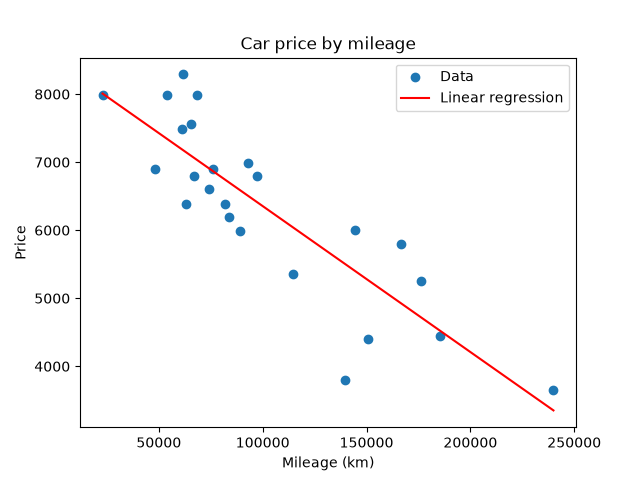

# ft_linear_regression

Predict the price of a car from its mileage with a linear regression trained by gradient descent.
Written from scratch in Python: no NumPy, no scikit-learn, only the standard library (plus matplotlib for the optional plot).



## Results

Trained on the 24 cars of `data.csv`:

| | Value |
|---|---|
| θ₀ (estimated price at 0 km) | 8499.60 |
| θ₁ (price change per km) | −0.021449 |
| MAE | 557.84 |
| RMSE | 667.57 |
| R² | 0.7330 |

The mileage alone explains 73 % of the price variation. On average, an estimate is off by about 560, roughly 9 % of the mean price.

## Usage

Requires Python 3. The three programs read `data.csv` and `thetas.txt` from the current directory.

```bash
# 1. Train the model: reads data.csv, writes theta0 and theta1 to thetas.txt
python3 train.py
theta0 = 8499.59964993321
theta1 = -0.021448963591702286

# 2. Estimate the price of a car
python3 predict.py
Enter a mileage (km): 150000
Estimated price: 5282.26

# 3. Measure the precision of the model
python3 evaluate.py
Evaluated on 24 rows
MAE  = 557.84
RMSE = 667.57
R2   = 0.7330
```

Before the first training, `thetas.txt` does not exist: `predict.py` uses θ₀ = θ₁ = 0 and every estimate is 0.

### Plot (optional)

The plot needs matplotlib. Install it in a virtual environment:

```bash
python3 -m venv .venv
source .venv/bin/activate
pip install matplotlib
python3 train.py --plot
```

`--plot` saves `plot.png` and opens a window. Without matplotlib, it prints a warning and the training still runs normally.

## How it works

### The model

$$\text{estimatePrice}(mileage) = \theta_0 + \theta_1 \times mileage$$

### Gradient descent

Starting from θ₀ = θ₁ = 0, each iteration goes through the m cars and computes:

$$tmp\theta_0 = learningRate \times \frac{1}{m} \sum_{i=0}^{m-1} \left(\text{estimatePrice}(mileage_i) - price_i\right)$$

$$tmp\theta_1 = learningRate \times \frac{1}{m} \sum_{i=0}^{m-1} \left(\text{estimatePrice}(mileage_i) - price_i\right) \times mileage_i$$

Both parameters are then updated at the same time, from the values of the previous iteration:

$$\theta_0 \leftarrow \theta_0 - tmp\theta_0 \qquad \theta_1 \leftarrow \theta_1 - tmp\theta_1$$

- `tmpθ₀` is the average error. It moves the line up or down.
- `tmpθ₁` weights each error by the mileage. It tilts the line.

These two terms are the derivatives of the mean squared error, so each step makes the error smaller.

### Normalization

Mileages (around 100 000) are much larger than prices (around 6 000). In `tmpθ₁`, the error is multiplied by the mileage, so the steps are huge and the training diverges.

`train.py` therefore standardizes the mileages before training, with μ their mean and σ their standard deviation:

$$x_{norm} = \frac{mileage - \mu}{\sigma}$$

The gradient descent learns `a` and `b` on this scale (`price = a × x_norm + b`). Replacing `x_norm` by its definition gives the parameters for real mileages, which are saved in `thetas.txt`:

$$\theta_1 = \frac{a}{\sigma} \qquad \theta_0 = b - \frac{a \times \mu}{\sigma}$$

With a learning rate of 0.1, the result no longer changes after about 200 iterations.

### Precision

`evaluate.py` compares the estimate of each car to its real price:

| Metric | Formula | Meaning |
|---|---|---|
| MAE | $\frac{1}{m} \sum \lvert error \rvert$ | average error, in price units |
| RMSE | $\sqrt{\frac{1}{m} \sum error^2}$ | like MAE, but large errors weigh more (always ≥ MAE) |
| R² | $1 - \frac{\sum error^2}{\sum (price - \overline{price})^2}$ | share of the price variation explained by the mileage: 1 is perfect, 0 is no better than always predicting the mean price |

## Error handling

The programs print a clear message instead of crashing when:

- `data.csv` is missing, unreadable, not a text file, or has no `km` / `price` column
- a row contains text, an empty value, `nan` or `inf` (the row is skipped)
- there are fewer than 2 valid rows, or all mileages are identical
- `thetas.txt` is unreadable or corrupted
- the mileage typed in `predict.py` is not a positive number (it is asked again), or the input is cancelled with Ctrl+C / Ctrl+D

## Files

| File | Role |
|---|---|
| `train.py` | trains the model and saves θ₀ and θ₁ to `thetas.txt` (`--plot` for the graph) |
| `predict.py` | asks for a mileage and prints the estimated price |
| `evaluate.py` | prints the precision of the model (MAE, RMSE, R²) |
| `data.csv` | dataset: mileage (`km`) and price of 24 cars |
| `docs/plot.png` | plot shown in this README |
